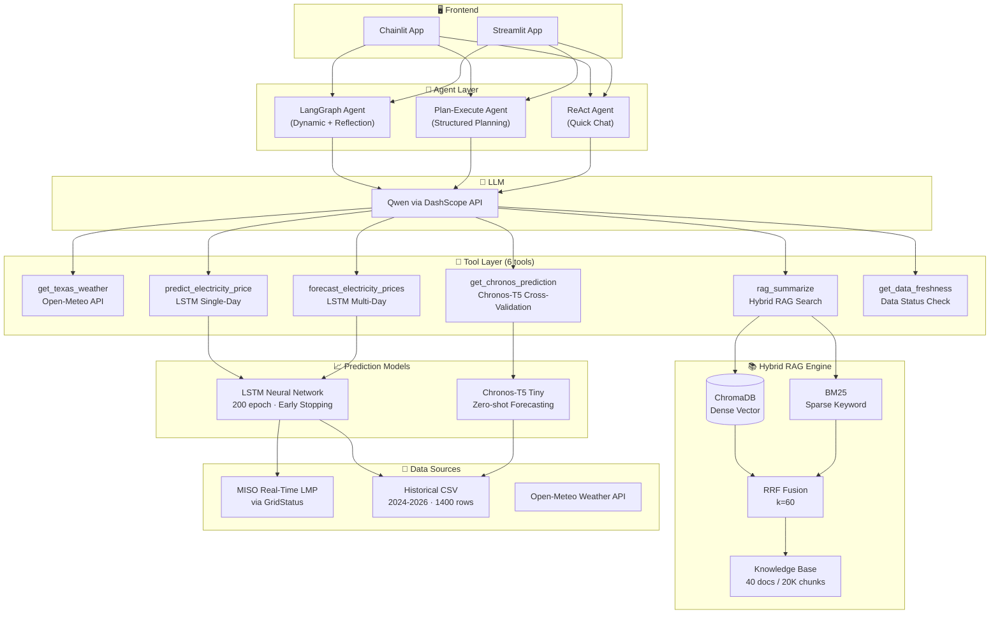
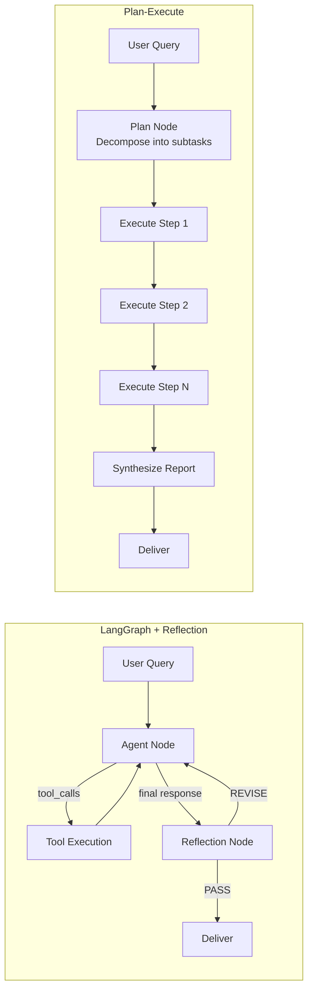

# ⚡ Electricity Price Intelligence

**Multi-Agent System for Electricity Price Forecasting & Market Intelligence**

LSTM + Chronos-T5 dual-track price prediction · Hybrid RAG (ChromaDB + BM25 + RRF) · Three Agent paradigms · Docker deployment

[](https://www.python.org/)
[](https://github.com/langchain-ai/langgraph)
[](https://pytorch.org/)
[](https://www.docker.com/)

---

## Architecture



---

## Agent Modes

| Mode | Strategy | Best For |
|------|----------|----------|
| **LangGraph Agent** | LLM autonomously decides which tools to call, with **Reflection** self-critique | Daily Q&A, single forecasts |
| **Plan-Execute Agent** | Decompose complex queries → Execute subtasks step-by-step → Synthesize report | Weekly briefings, full reports |
| **ReAct Agent** | Classic Reason-Act loop | Quick, simple queries |

### Agent Flow Comparison



---

## Evaluation Results

### LSTM Price Prediction (30-day test, Indiana Hub)

| Metric | Univariate (price only) | **Multivariate (price+weather)** |
|--------|------------------------|----------------------------------|
| MAE | 10.31 $/MWh | **8.23 $/MWh** (-20%) |
| RMSE | 14.52 $/MWh | **12.25 $/MWh** |
| MAPE | 30.0% | **25.3%** |
| R² | -0.34 | **0.05** |
| Price Mean | 36.53 $/MWh | 36.53 $/MWh |
| Price Std | 12.56 $/MWh | 12.56 $/MWh |

*Multivariate model integrates 4 weather features (temp_max, temp_min, precipitation, wind_speed) via Open-Meteo API, achieving 20% MAE reduction over the price-only baseline.*

### Hybrid RAG Retrieval (20,857 chunks, top-3)

| Retriever | Hit Rate@3 | MRR |
|-----------|-----------|-----|
| Vector Only (ChromaDB) | 82.5% | 0.767 |
| BM25 Only | 98.75% | 0.956 |
| **Hybrid RRF** | **96.25%** | **0.877** |

---

## Tech Stack

| Layer | Technologies |
|-------|-------------|
| **Agent Framework** | LangGraph, LangChain |
| **LLM** | Qwen (DashScope API) |
| **Vector Database** | ChromaDB |
| **Sparse Retrieval** | BM25 (rank-bm25) |
| **Fusion Algorithm** | RRF (Reciprocal Rank Fusion, k=60) |
| **Deep Learning** | PyTorch, LSTM, Chronos-T5 |
| **Frontend** | Chainlit, Streamlit, Plotly |
| **Data Fetching** | GridStatus (MISO), Open-Meteo (Weather), EIA API |
| **Deployment** | Docker, docker-compose, systemd, nginx |
| **Data Processing** | Pandas, NumPy, scikit-learn |

---

## Quick Start

```bash
# 1. Clone & install
git clone <repo-url>
cd "Agent Project"
pip install -r requirements_deploy.txt
pip install torch --index-url https://download.pytorch.org/whl/cpu

# 2. Configure environment
cp .env.example .env
# Edit .env: add DASHSCOPE_API_KEY, optional EIA_API_KEY

# 3. Model config (config/rag.yml)
#   chat_model_name:  any Model Studio chat model with quota, e.g. qwen3.7-flash-2026-07-15
#                     (must have free quota enabled in the Model Studio console)
#   embedding_model_name: text-embedding-v4 or qwen3.7-text-embedding
# Note: chat models are called via the OpenAI-compatible endpoint, so newer
# qwen3.x models work even though the legacy dashscope SDK does not serve them.

# 3. Load knowledge base & train model
python -c "from rag.vector_store import VectorStoreService; VectorStoreService().load_document()"
python -c "from algorithms.epf_predictor import train_model; train_model()"

# 4. Launch
chainlit run chainlit_app.py --port 8000   # Chainlit (recommended, 4 agent modes + long-term memory)
# or
streamlit run app.py --server.port 8501   # Streamlit
# or
python -m uvicorn api.main:app --host 0.0.0.0 --port 8001   # FastAPI agent service
```

### Agent REST/SSE API

The multi-agent system is also exposed as a FastAPI service (see `api/`):

| Endpoint | Description |
|----------|-------------|
| `GET /api/health` | Service status, agent modes, RAG readiness |
| `GET /api/tools` | Registry of all 10 tools (name / description / args schema) |
| `POST /api/chat` | Full agent response (choose `mode`: `langgraph` / `plan_execute` / `react` / `supervisor`) |
| `POST /api/chat/stream` | SSE streaming: `step_running` / `step_done` / `response_chunk` / `response_done` |
| `POST /api/predict` | LSTM single-day or multi-day forecast (+ Chronos cross-check) |
| `POST /api/rag/search` | Hybrid RAG (ChromaDB + BM25 + RRF) with citation chunks |
| `POST /api/memory` | Long-term memory: user preferences + prediction history |

- Interactive docs (OpenAPI): `http://127.0.0.1:8001/docs`
- Optional API-key auth: set `API_KEY` in `.env`; requests then need `X-API-Key` header
- Chat model goes through the DashScope OpenAI-compatible endpoint (`compatible-mode/v1`) — see `config/rag.yml`

### Engineering Layers (beyond the UI)

- **Multi-agent Supervisor** (`agent/supervisor_agent.py`): Coordinator LLM routes requests to specialist agents (Weather / Forecast / Research) + synthesizer.
- **Long-term memory** (`memory/`): SQLite-backed preferences, prediction history, conversation summaries; injected into agent prompts.
- **Observability** (`observability/trace.py`): pluggable trace recorder — local JSONL by default, Langfuse backend when `LANGFUSE_*` env vars are set.
- **Agent evaluation** (`eval/`): 16+ cases across chat/weather/forecast/RAG/trading; cross-paradigm comparison with LLM judge scoring. Run: `python eval/run_eval.py`

### Testing & CI

- **75 pytest cases** (`tests/`): unit tests for date parsing / tool registry / memory / trace / config / schemas / eval framework / supervisor routing, plus FastAPI integration tests.
- **Credential-aware**: live-model tests are marked `integration` and auto-skipped when `DASHSCOPE_API_KEY` is absent — so CI runs the full suite without secrets (73 passed, 2 skipped, ~22s) and with secrets runs everything (75 passed).
- **Lazy model loading**: `ChatOpenAI` validates the API key at construction, so models are built through a lazy proxy (`model/factory.py`) on first use — the whole app imports cleanly in credential-less environments.
- **GitHub Actions** (`.github/workflows/ci.yml`): three jobs —
  - `test` — full suite, needs **no** secrets (verified against a credential-less checkout: 73 passed / 2 skipped)
  - `eval` — agent evaluation; enable by setting the repository **secret** `DASHSCOPE_API_KEY` **and** the repository **variable** `RUN_EVAL=true` (a job-level `if` cannot read `secrets`, so the job is gated by a variable and skips gracefully when the secret is missing). Also runnable on demand via *Actions → Run workflow*.
  - `syntax` — `compileall` smoke test
  - Both torch-installing jobs use the **CPU-only wheel** (`--index-url https://download.pytorch.org/whl/cpu`) to avoid pulling the ~2 GB CUDA build.

```bash
pip install pytest
python -m pytest              # all tests (live-model tests need DASHSCOPE_API_KEY)
python -m pytest -m "not integration"   # fast offline suite
```

### Docker

```bash
docker-compose up -d
# Visit http://localhost:8000
```

---

## Project Structure

```
Agent Project/
├── agent/
│   ├── langgraph_agent.py       # Dynamic agent + Reflection (LangGraph)
│   ├── plan_execute_agent.py    # Plan-then-execute agent
│   ├── react_agent.py           # ReAct quick-chat agent
│   ├── supervisor_agent.py      # Multi-agent supervisor (Coordinator + 3 specialists + synthesizer)
│   └── tools/
│       ├── agent_tools.py       # 10 tools (weather, price, RAG, alerts, briefing...)
│       └── middleware.py        # Tool monitoring / prompt-switch middleware
├── api/                         # FastAPI agent service (REST + SSE)
│   ├── main.py                  # App + CORS + router wiring
│   ├── schemas.py               # Pydantic contracts (auto OpenAPI)
│   ├── deps.py                  # API-key auth dependency
│   └── routers/                 # chat / forecast / rag / tools / memory / health
├── algorithms/
│   ├── epf_predictor.py         # LSTM training, inference & date parsing
│   ├── price_data_provider.py   # CSV & live data interface
│   ├── gridstatus_feed.py       # MISO real-time LMP fetcher
│   └── eia_price_fetcher.py     # EIA API data fetcher
├── rag/
│   ├── vector_store.py          # Hybrid retriever (Chroma + BM25 + RRF)
│   └── rag_service.py           # RAG summarization
├── memory/                      # SQLite long-term memory
│   ├── store.py                 # Preferences / prediction history / session summaries
│   └── service.py               # Extraction + prompt injection
├── observability/
│   └── trace.py                 # Pluggable trace (JSONL default / Langfuse optional)
├── eval/                        # Agent evaluation suite
│   ├── cases.py                 # 17 cases × 5 categories
│   ├── runner.py                # 4-paradigm runner + LLM judge
│   ├── report.py                # Markdown report builder
│   └── run_eval.py              # CLI entry
├── tests/                       # 75 pytest cases (unit + integration)
├── model/
│   └── factory.py               # Lazy chat/embedding model factories
├── scripts/                     # eval / retrain / sync scripts
├── config/                      # rag.yml / chroma.yml / prompts.yml / agent.yml
├── data/                        # Knowledge base documents
├── .github/workflows/ci.yml     # GitHub Actions (test / eval / syntax)
├── chainlit_app.py              # Chainlit frontend (4 modes + memory display)
├── app.py                       # Streamlit frontend
├── Dockerfile
├── docker-compose.yml
├── requirements.txt             # → requirements_deploy.txt (runtime) + requirements-dev.txt (dev)
└── pytest.ini
```

---

## Key Innovations

1. **Four Agent Paradigms**: LangGraph + Reflection, Plan-Execute, ReAct, and a Supervisor multi-agent hierarchy (Coordinator routes to Weather/Forecast/Research specialists + synthesizer) — all switchable at runtime for head-to-head comparison.

2. **Self-Correcting Agent**: Reflection node critiques its own responses for factual accuracy, completeness, and clarity, then auto-revises before delivery.

3. **Hybrid RAG with RRF**: Custom implementation combining ChromaDB dense vectors and BM25 sparse retrieval via Reciprocal Rank Fusion (k=60), achieving 96%+ hit rate on 20K+ chunks.

4. **Dual-Track Price Forecasting**: LSTM neural network (200-epoch training with early stopping) paired with Chronos-T5 zero-shot model for cross-validation.

5. **Production-Ready Engineering**: FastAPI service (REST + SSE) with Pydantic contracts & optional API-key auth · SQLite long-term memory · pluggable observability (JSONL → Langfuse) · agent evaluation suite (4-paradigm comparison) · 75 pytest cases with credential-aware skips · GitHub Actions CI · Docker + docker-compose deployment.
