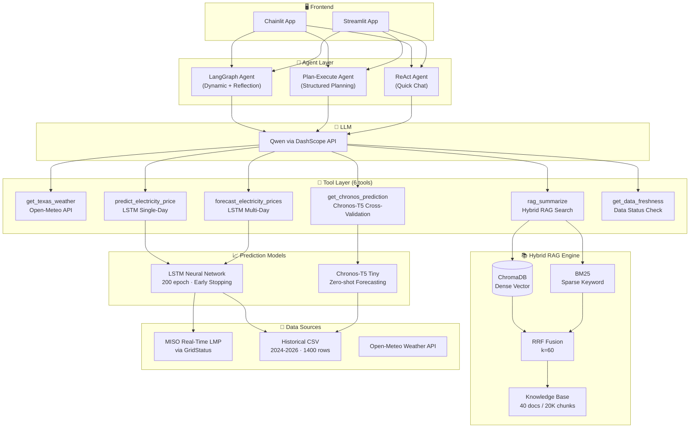
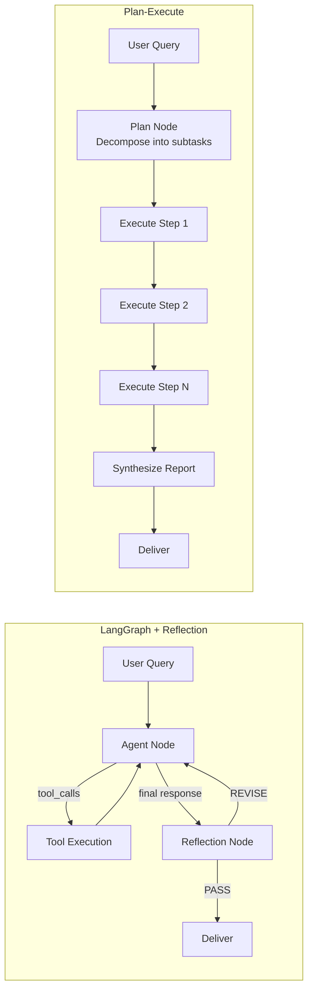

# ⚡ Electricity Price Intelligence

**Multi-Agent System for Electricity Price Forecasting & Market Intelligence**

LSTM + Chronos-T5 dual-track price prediction · Hybrid RAG (ChromaDB + BM25 + RRF) · Three Agent paradigms · Docker deployment

[](https://www.python.org/)
[](https://github.com/langchain-ai/langgraph)
[](https://pytorch.org/)
[](https://www.docker.com/)

---

## Architecture



---

## Agent Modes

| Mode | Strategy | Best For |
|------|----------|----------|
| **LangGraph Agent** | LLM autonomously decides which tools to call, with **Reflection** self-critique | Daily Q&A, single forecasts |
| **Plan-Execute Agent** | Decompose complex queries → Execute subtasks step-by-step → Synthesize report | Weekly briefings, full reports |
| **ReAct Agent** | Classic Reason-Act loop | Quick, simple queries |

### Agent Flow Comparison



---

## Evaluation Results

### LSTM Price Prediction (30-day test, Indiana Hub)

| Metric | Univariate (price only) | **Multivariate (price+weather)** |
|--------|------------------------|----------------------------------|
| MAE | 10.31 $/MWh | **8.23 $/MWh** (-20%) |
| RMSE | 14.52 $/MWh | **12.25 $/MWh** |
| MAPE | 30.0% | **25.3%** |
| R² | -0.34 | **0.05** |
| Price Mean | 36.53 $/MWh | 36.53 $/MWh |
| Price Std | 12.56 $/MWh | 12.56 $/MWh |

*Multivariate model integrates 4 weather features (temp_max, temp_min, precipitation, wind_speed) via Open-Meteo API, achieving 20% MAE reduction over the price-only baseline.*

### Hybrid RAG Retrieval (20,857 chunks, top-3)

| Retriever | Hit Rate@3 | MRR |
|-----------|-----------|-----|
| Vector Only (ChromaDB) | 82.5% | 0.767 |
| BM25 Only | 98.75% | 0.956 |
| **Hybrid RRF** | **96.25%** | **0.877** |

---

## Tech Stack

| Layer | Technologies |
|-------|-------------|
| **Agent Framework** | LangGraph, LangChain |
| **LLM** | Qwen (DashScope API) |
| **Vector Database** | ChromaDB |
| **Sparse Retrieval** | BM25 (rank-bm25) |
| **Fusion Algorithm** | RRF (Reciprocal Rank Fusion, k=60) |
| **Deep Learning** | PyTorch, LSTM, Chronos-T5 |
| **Frontend** | Chainlit, Streamlit, Plotly |
| **Data Fetching** | GridStatus (MISO), Open-Meteo (Weather), EIA API |
| **Deployment** | Docker, docker-compose, systemd, nginx |
| **Data Processing** | Pandas, NumPy, scikit-learn |

---

## Quick Start

```bash
# 1. Clone & install
git clone <repo-url>
cd "Agent Project"
pip install -r requirements_deploy.txt
pip install torch --index-url https://download.pytorch.org/whl/cpu

# 2. Configure environment
cp .env.example .env
# Edit .env: add DASHSCOPE_API_KEY, optional EIA_API_KEY

# 3. Load knowledge base & train model
python -c "from rag.vector_store import VectorStoreService; VectorStoreService().load_document()"
python -c "from algorithms.epf_predictor import train_model; train_model()"

# 4. Launch
chainlit run chainlit_app.py --port 8000   # Chainlit (recommended)
# or
streamlit run app.py --server.port 8501   # Streamlit
```

### Docker

```bash
docker-compose up -d
# Visit http://localhost:8000
```

---

## Project Structure

```
Agent Project/
├── agent/
│   ├── langgraph_agent.py      # Dynamic agent + Reflection
│   ├── plan_execute_agent.py   # Plan-then-execute agent
│   ├── react_agent.py          # ReAct quick-chat agent
│   └── tools/
│       └── agent_tools.py      # 6 tools (weather, price, RAG, etc.)
├── algorithms/
│   ├── epf_predictor.py        # LSTM model training & inference
│   ├── price_data_provider.py  # CSV & live data interface
│   ├── gridstatus_feed.py      # MISO real-time LMP fetcher
│   └── eia_price_fetcher.py    # EIA API data fetcher
├── rag/
│   ├── vector_store.py         # Hybrid retriever (Chroma + BM25 + RRF)
│   └── rag_service.py          # RAG summarization chain
├── scripts/
│   ├── evaluate_lstm.py        # LSTM model evaluation
│   ├── evaluate_rag.py         # RAG retrieval evaluation
│   ├── update_and_retrain.py   # Auto data update + retrain
│   ├── sync_to_server.py       # Deploy to cloud server
│   └── weekly_update.bat       # Scheduled update task
├── config/
│   └── chroma.yml              # RAG & ChromaDB settings
├── data/                       # Knowledge base documents (40+ files)
├── chainlit_app.py             # Chainlit frontend
├── app.py                      # Streamlit frontend
├── Dockerfile
├── docker-compose.yml
└── requirements_deploy.txt
```

---

## Key Innovations

1. **Three Agent Paradigms**: LangGraph dynamic agent with Reflection, Plan-Execute structured planning, and ReAct — all switchable at runtime for head-to-head comparison.

2. **Self-Correcting Agent**: Reflection node critiques its own responses for factual accuracy, completeness, and clarity, then auto-revises before delivery.

3. **Hybrid RAG with RRF**: Custom implementation combining ChromaDB dense vectors and BM25 sparse retrieval via Reciprocal Rank Fusion (k=60), achieving 96%+ hit rate on 20K+ chunks.

4. **Dual-Track Price Forecasting**: LSTM neural network (200-epoch training with early stopping) paired with Chronos-T5 zero-shot model for cross-validation.

5. **Production-Ready**: Docker containerization with docker-compose, systemd service management, nginx reverse proxy, and automated data pipeline.
